User profile and roles
########################################################################################################################

Knowage users are defined by:

- identities,
- roles,
- profiles.

The *identity* of a user consists of a set of data used to identify that user, i.e., a username and a password, as well as a human readable full name.

The *profile* of a user consists of a set of properties called attributes, describing general information about the user, e.g., age and gender, but also domain-specific properties, such as the organizational unit to which he belongs. Some attributes, such as name and email, are defined by default in Knowage. Others can be added by the model administrator, as explained in the following sections.

The *role* of a user represents a categorization of a group of users. These roles may correspond to specific positions in the company, e.g., “general manager” or a “sales director”, or to a position with respect to the BI project, e.g., “data administrator” and “BI developer”. Different users may have the same role, as well as the same user may have multiple roles.

You will not have grants to create new roles or users, but you are asked to match them during document profilation phases. In the following we are going to describe the elements needed for adding parameters. This elements involves profilation too. To conclude we will see how to manage accessibility while creating a document.

.. _knowageroletype:
.. table:: Knowage Role Types.
    :widths: auto

    +-----------------------+-----------------------+-----------------------+
    |    Role Type          | Description           | Standard User         |
    +=======================+=======================+=======================+
    |    ADMIN              | General               | biadmin               |
    |                       | administrator.        |                       |
    |                       |                       |                       |
    |                       | Manages all Knowage   |                       |
    |                       | functionalities.      |                       |
    +-----------------------+-----------------------+-----------------------+
    |    MODEL_ADMIN        | Model administrator.  | bimodel               |
    |                       |                       |                       |
    |                       | Manages the           |                       |
    |                       | Behavioural Model and |                       |
    |                       | its associated        |                       |
    |                       | functionalities.      |                       |
    +-----------------------+-----------------------+-----------------------+
    |    DEV_ROLE           | Developer.            | bidev                 |
    |                       |                       |                       |
    |                       | Creates and modifies  |                       |
    |                       | datasets and          |                       |
    |                       | documents.            |                       |
    +-----------------------+-----------------------+-----------------------+
    |    TEST_ROLE          | Test user.            | bitest                |
    |                       |                       |                       |
    |                       | Tests analytical      |                       |
    |                       | documents.            |                       |
    +-----------------------+-----------------------+-----------------------+
    |    USER               | End user.             | biuser                |
    |                       |                       |                       |
    |                       | Executes documents    |                       |
    |                       | visible to him and    |                       |
    |                       | creates ad-hoc        |                       |
    |                       | reporting analysis.   |                       |
    +-----------------------+-----------------------+-----------------------+

Knowage allows you to create several roles, according to your project needs. However, all roles must belong to a specific *role type*. A role type is a higher-level categorization used by Knowage, in order to map roles for the different features of the suite.

Pre-defined roles are summarized in the Table 5.1. The first four roles are technical roles, while the last one, the user, is the actual end user. Each role type has a default user associated to it. Other users can be created and associated to a role type.

Users' profiles are automatically loaded when logging in into Knowage. The full name is visible by clicking on the info button at the bottom left corner of the page.

Authentication can be handled internally by Knowage or delegated to an external Single Sign On (SSO) system.

   .. hint::
      **Authentication Management**:
         The choice of handling authentication internally or delegating it to an external SSO system typically depends on the presence of an authentication system already in place. If this is the case, Knowage can seamlessly integrate with the existing authentication infrastructure.

As for profiles, users' roles are loaded when they log in into Knowage. Roles are managed internally. In case of multiple roles, they will be asked to choose one.

Alternatively, from the Knowage Administrator menu *PROFILE MANAGEMENT > Users* it is possible to select a default role that will be kept valid until logging out.

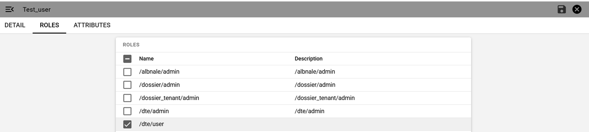

   User's roles in Knowage.

Steps to follow in the definition of a behavioural model:

-  Create profile attributes;
-  Create roles;
-  Create users and associate profile attribute values and roles to them.

As shown before, Knowage supports the management of user's profiles and roles through the **Profile Management** menu section. This menu is only visible to Knowage administrators and model administrators, since users and roles management is a critical operation that requires an appropriate level of responsibility.

The **Profile Management** menu section contains three sub-menu items:

-  **Profile Attributes**: to define new profile attributes and manage the existing ones.

-  **Roles**: to create new roles and manage permissions for each role.

-  **Users**: to create users, manage their identities, assign values to their profile attributes and associate them with roles.

In the following, we show how the model administrator can define user profiles and roles using these functionalities. Remember that Knowage profile management can also be integrated with external profiling systems.

Clicking on **Profile Attributes**, the list of currently defined attributes is shown. To add a new attribute, click on the **Plus icon**: a new row is added to the list, where you can insert the Name, the Description and the Data type. To delete an attribute, select the corresponding row and click on the **Delete** icon.

Attributes defined in this section will be available to all user profiles. It is not mandatory to assign a value to each attribute for each user, since profile attributes without values will not be considered in the definition of the user profile.

In addition to the profile attributes created by administrator, by default Knowage provides the following profile attributes:

-   **user_id**: set with the user unique identifier;

-   **user_roles**: set with user roles selected from the ROLES tab in Users Management menu;

-   **TENANT_ID**: set with the tenant unique identifier;

-   **user_session_roles**: set like *user_roles* attribute, if no default role is set. Set with default role selected, otherwise.

-   **language**: set with the language selected by the user

The image below shows a new *Profile attribute* named *Country* whose value has been manually entered. An alternative option is to feed attribute values by means of a Lov: one or more of its values will be asigned by the user. Multivalue option in this case is not enabled, so only one value is inserted.

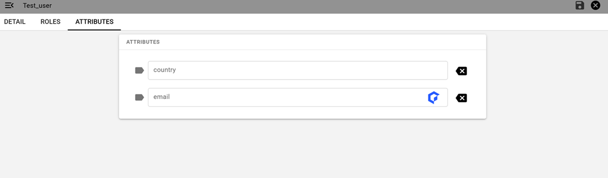

   Profile attributes Management.

Once the attributes are defined, the model administrator can define roles, using the **Roles** functionality. The role management tool is two-sided: on the left you can see the list of already defined roles. At the beginning of a project, only default roles are visible. To add a new role, click the **Plus** icon and move to the right panel. To delete a role, simply click on the **Delete** icon available for that role once saved.

   .. hint::
      **Role Management**:
         The behavioural model should be built taking into account the specificity of each organization and the needs of the BI project.    Therefore, it is a good practice to define specific roles for the BI project and avoid using Knowage technical roles only.

The right panel contains the following tabs.
The **Detail** tab allows the administrator to define role name and role type (mandatory).
The role type regulates the visibility of that role based on the types already described.
A code and a description can be added as shown below.

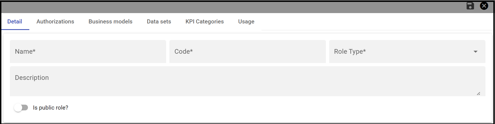

   Details tab in Roles Management.

The **Authorizations** tab allows you to assign permissions to each role. Rights are predefined and grouped into categories, as shown above.

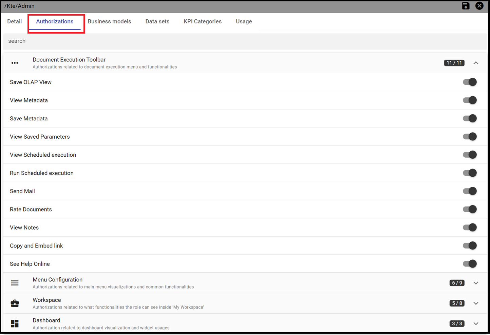

   Authorization tab in Roles Management.

Use the **Business Models** and **Data sets** tabs to assign categories to each
role. Users can access the business models and datasets belonging to the
categories associated with their roles. The tabs available depend on the
installed components. See :doc:`/chapter_3/create_qbe/index` and
:doc:`/chapter_3/create_dataset/index` for the corresponding authoring guides.

There is a last tab **Usage** that represents a summary tab of the usage of that role inside Knowage.

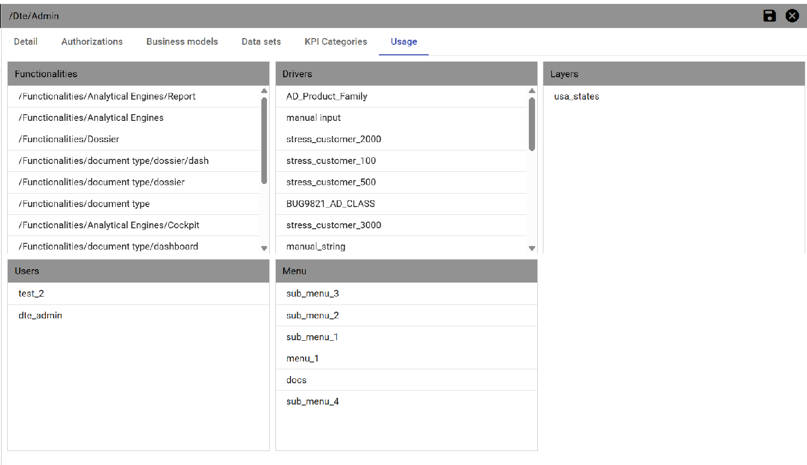

   Usage tab in Roles Management.

User Management
------------------------------------------------------------------------------------------------------------------------

The **Users Management** section includes a left panel that allows the administrator to create and delete users, and a right panel that allows the management of user details, roles and attributes.

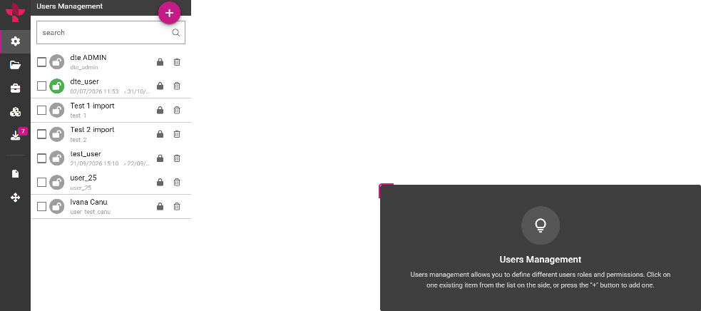

   Users Management.

.. _bulk_user_insertion:

Bulk User Insertion
~~~~~~~~~~~~~~~~~~~

Knowage allows the administrator to perform a massive insertion of new users simultaneously by uploading a structured file. The supported file formats are **CSV** (UTF-8 with a semicolon ``;`` separator) and **XLSX**. Use XLSX for Excel imports; the upload chooser also lists the legacy XLS extension.

To access this feature, navigate to the User Management section and click on the **Import** action in the Users Management toolbar.

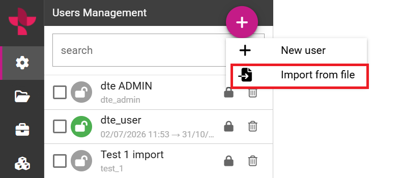

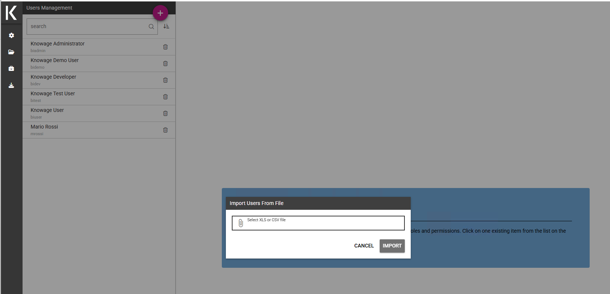

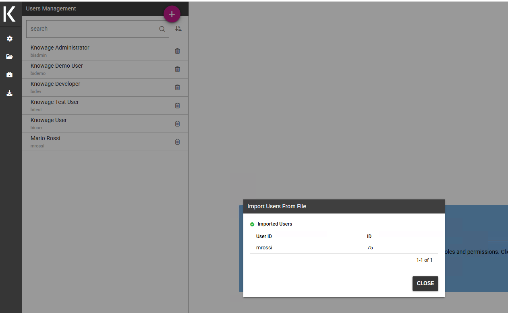

Structure and Requirements
^^^^^^^^^^^^^^^^^^^^^^^^^^

.. warning::
   **No header row** must be included in the file. Data rows must start from the very first line.

Keep at least the first three columns in every row, using blank values for optional cells. Each row represents a single user to be created. The columns must follow this precise sequential order:

1. **User ID** (Mandatory): The unique identifier for the user login.
2. **Password**: the initial password. A blank value uses the configured default password when available; explicit passwords must satisfy the password policy.
3. **Full Name** (Optional): The first and last name of the user.
4. **Roles / Profiles** (Optional): The technical or business roles to be assigned to the user (e.g., ``admin``, ``user``).

   *Multiple Roles:* It is possible to specify more than one role for a single user. In this case, additional roles must occupy the subsequent columns (e.g., column 5, column 6, etc.), shifting the position of the attributes.

5. **Attributes** (Optional): Custom user profile attributes required by the analytical documents. Supply each relevant attribute explicitly in every row, including empty values, and check the imported profiles.

   * *Format:* Attributes must be provided as a key-value pair separated by a colon ``:``, using the syntax ``label:value`` (e.g., ``email:m.rossi@eng.it`` or ``birth_date:09061976``).
   * *Multiple Attributes:* Multiple attributes can be defined sequentially after the roles section.

Examples
^^^^^^^^

**CSV Format Example (with semicolon separator):**

.. code-block:: text

   mrossi;Marz0_2026;Mario Rossi;admin;birth_date:09061976;email:m.rossi@eng.it
   jsmith;Secret_2026;John Smith;user;dev;email:j.smith@eng.it

**Excel Format Example:**

.. list-table::
   :widths: 15 15 20 10 20 20
   :header-rows: 0

   * - mrossi
     - Marz0_2026
     - Mario Rossi
     - admin
     - birth_date:09061976
     - email:m.rossi@eng.it
   * - jsmith
     - Secret_2026
     - John Smith
     - user
     - dev
     - email:j.smith@eng.it

Upload Execution and Output Report
^^^^^^^^^^^^^^^^^^^^^^^^^^^^^^^^^^

Once the file is selected and uploaded, the system processes each record sequentially and shows successful users and errors separately. The underlying service returns a per-user JSON report, illustrated below.

Each item in the response contains:

* ``userId``: The identifier of the processed user.
* ``success``: A boolean value (``true`` or ``false``) stating whether the user creation succeeded.
* ``createdUserId``: The numeric ID generated by the database (populated only in case of success).
* ``message``: A descriptive message confirming the operation or explaining the specific validation error (e.g., password criteria failure, missing mandatory field, or database constraints).

**Response Example:**

.. code-block:: json

   [
     {
       "userId": "mrossi",
       "success": true,
       "createdUserId": 10521,
       "message": "User processed successfully"
     },
     {
       "userId": "jsmith",
       "success": false,
       "createdUserId": null,
       "message": "Password is not valid"
     }
   ]

User unlock
~~~~~~~~~~~

If a user reaches the maximum number of failed login attempts (editable in advanced configurations), that user will be blocked by Knowage and access will be denied.
By accessing Knowage with management privileges, the blocked user will be displayed with a red warning sign and it will be possible to unlock it by using the "unlock user" button.
After that, the user will be able to log in using the latest set of credentials.

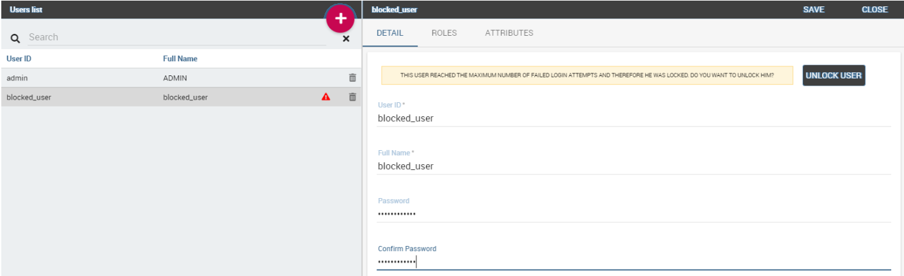

    Users Management - Roles settings example

Roles settings
~~~~~~~~~~~~~~

Clicking on the ROLES tab you have to select one o more roles to associate with the user.
After that, if more than one role is associated to the user, you can choose the default role by selecting it from the combo box on the top of the page.

Default role is optional: if you don't select a default role, at login time all the available roles for the user will be loaded. If you select a role, at login time
it will be the session role selected.

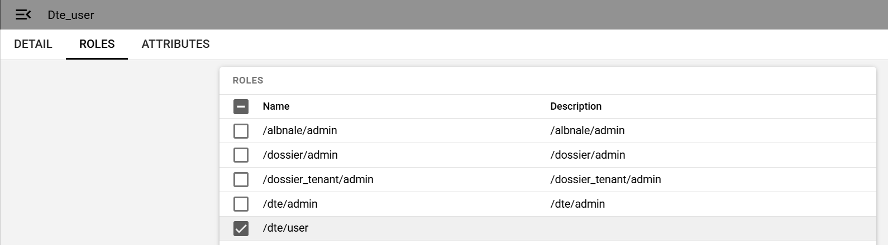

    Users Management - Roles tab

In the example above, for the user "*Dte user*" whose role is just *user*.

You can also assign an attribute profile to a user. In this case it is enough to valorize the attribute that you want to assign.
The below image, shows an example. The attribute *par_family* that has been formerly created as a *Profile attribute*.

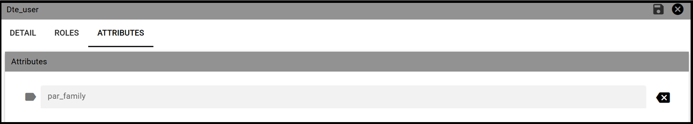

    Users Management - Attributes tab

Bulk maintenance
----------------

Users Management supports selecting several users for bulk actions. Review
the selected identities before applying role or profile-attribute changes;
inspect the per-user result report afterwards. Imported roles and profile
attributes should already be defined in the target tenant.

.. figure:: /_static/screenshots/9.1/chapter-3-security-management-role-user-9-1-users-bulk-actions.png

   User selection, bulk maintenance and per-user results.
