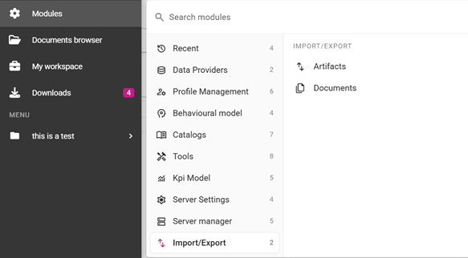
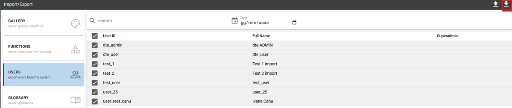
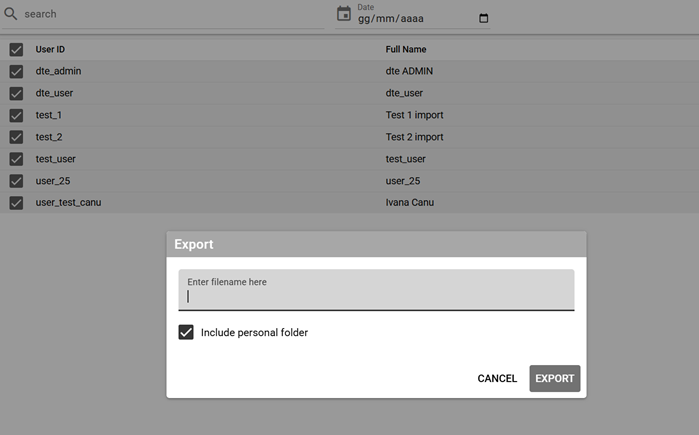
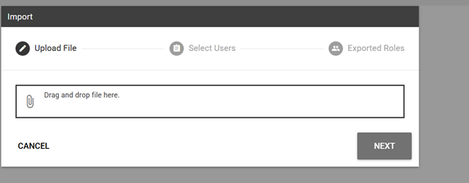
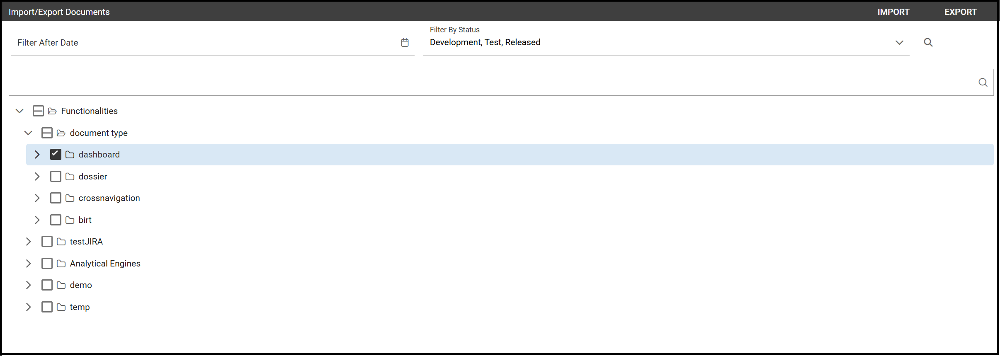
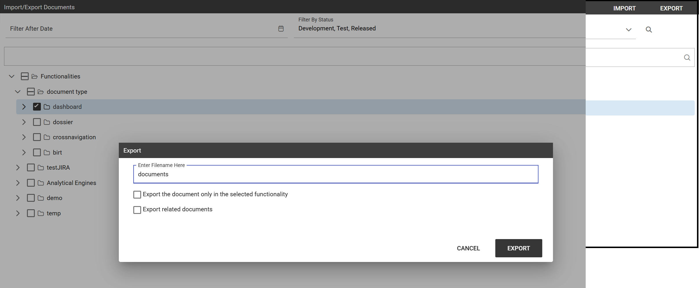
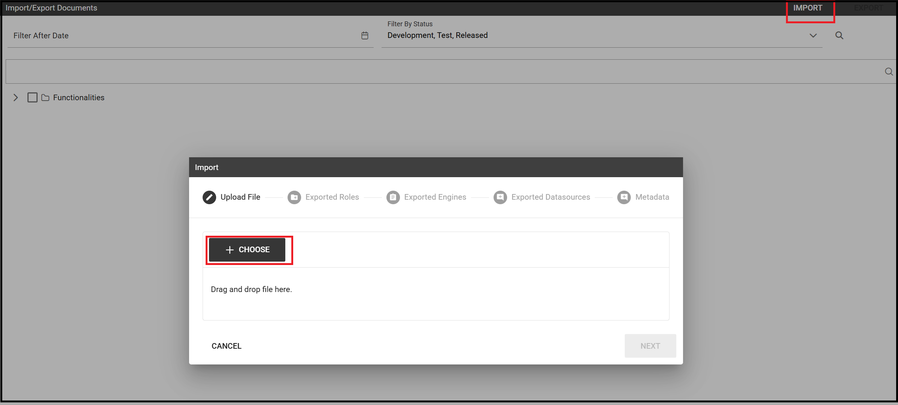
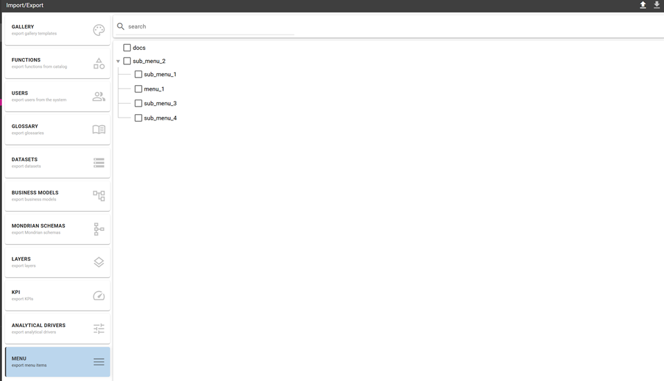
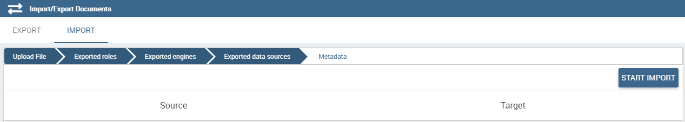

Import/Export
------------------------------------------------------------------------------------------------------------------------

This functionality allows to import/export items belonging to *Gallery*, *Documents*, *Menu*, *Users*, *KPIs* and *Catalogs*.
After exporting, the user can import the information previously extracted into a different Knowage installation or tenant.

   Import/Export menu

Artifacts
~~~~~~~~~~~~~~~~~~~~~~~~~~~~~~~~~~~~~~~~~~~~~~~~~~~~~~~~~~~~~~~~~~~~~~~~~~~~~~~~~~~~~~~~~~~~~~~~~~~~~~~~~~~~~~~~~~~~~~~~

**Export**

It is possible to export widgets and functions to a zip file to use afterwards as a *source* to be imported to a different environment.
As shown below, select the items of your interest and click the *EXPORT* icon.

    Artifacts Export

After the selection, give a name to the file and confirm with *Export* button.

    Artifacts Export - setting name for zip file

**Import**

You can import the zip file formerly exported just clicking the *IMPORT* icon and then clicking the *Drag and drop file here* area to select the file. See below image:
You can also drag the file.

    Artifacts Import - Export file selection #1

After selecting the file to import the *NEXT* button will became available to select Users and Roles subsequently.

Documents
~~~~~~~~~~~~~~~~~~~~~~~~~~~~~~~~~~~~~~~~~~~~~~~~~~~~~~~~~~~~~~~~~~~~~~~~~~~~~~~~~~~~~~~~~~~~~~~~~~~~~~~~~~~~~~~~~~~~~~~~

This feature allows to download a zip file of the whole or a part of the documents existing in your Knowage installation.

Below, you can see how the export editor looks like.

    Document Export

Fill in the name of your export and select which documents to export. You can browse through folders by clicking on the relative icon. Check the items to include in the file.
The export icon changes colour from grey to pink.
After clicking the *Export* button you can decide whether to include or not the following options:

- **Export the document only in the selected functionality**
   By checking this property, the export will include documents only if they are inside a selected functionality.
- **Related documents**
   By checking this property, the export will include all those documents linked through the cross navigation to the selected documents.

    Document Export options

To import documents click on the *IMPORT* link, choose or drag your file and click the *NEXT* button.

The below image shows the other artifacts that can be imported/exported:

    Import/Export options

    Document Import

You will be asked to map *Roles*, *Engines*, *Datasources* and *Metadata* from *Source* to *Target*.
After compliting all the steps to Metadata, you can start the import.

   Document Import Wizard

If a role does not match any of the existing ones, the role will be created.
**Please bear in mind that all the target metadata with the same label i.e. documents, lovs, drivers will be overwritten when importing**.
