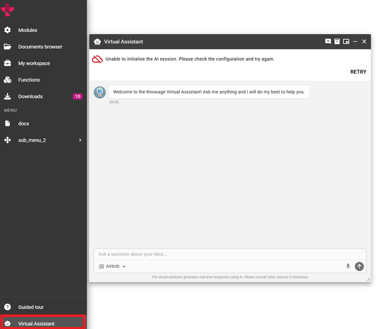

AI assistant
============

.. important:: Enterprise Edition (EE) only

   The AI assistant is reserved for **Knowage Enterprise Edition (EE)**.
   It requires an EE license, a configured AI service and permission to use it.

Open the assistant from the main menu with an authorized account.

1. Choose one of the business models available in the model selector.
2. Wait for the session to connect, then enter a question about that model.
3. Read the answer and use the supplied document links or result artifacts
   where available.
4. Refine the question with the period, measure, grouping or comparison you need.

For example, ask for sales by region for a specified year, then ask which
regions contributed most to the change from the previous year. Choose a model
covering those business concepts.

Review the returned filters, units and figures before reusing an answer in a
report. The available models and outputs depend on the configured AI service.

Use the conversation controls to start a new conversation, inspect available
history or open the artifact panel. Changing the business model can require
confirmation before the current conversation is replaced. Minimize the panel
to return to your analysis and reopen it when needed.

   AI model selection, question, answer and result artifacts.

If the assistant cannot connect, use the retry action and ask the administrator
to check the AI service. If the model list is empty, the administrator must
configure and synchronize the models available for AI use.
