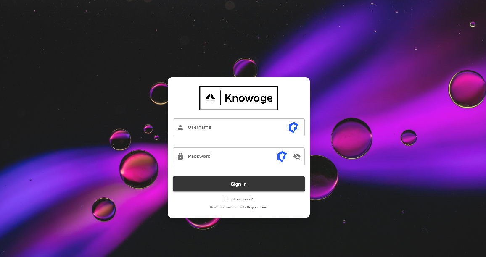
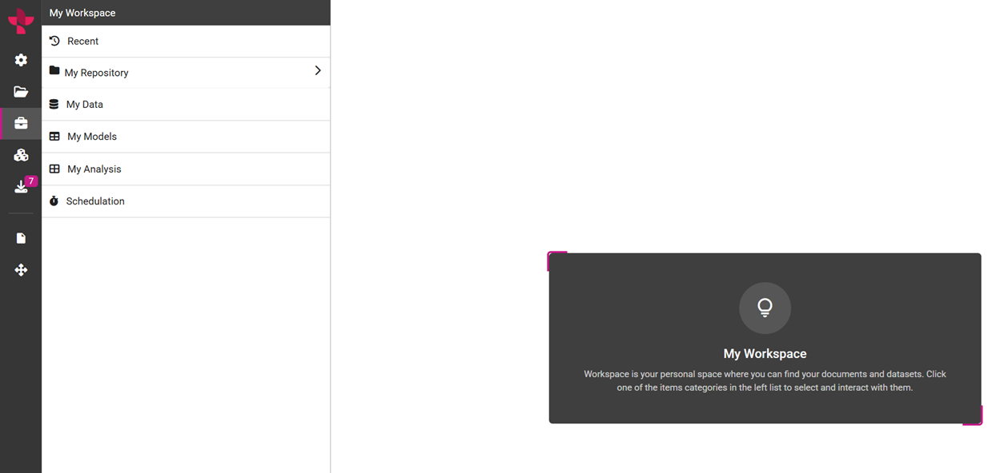
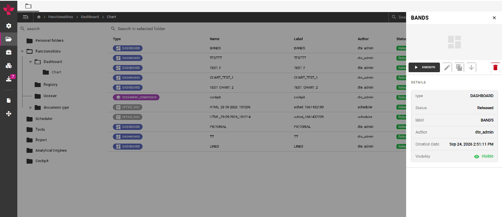

User Interface
========================================================================================================================

This chapter focuses on Knowage user interface, providing detailed information on the Main Menu, the Document Browser and some general settings concerning analytical documents. First of all, a short introduction on profiling rules its provided.

Preliminary information
------------------------------------------------------------------------------------------------------------------------

The administrator will provide you a username and a password to log in Knowage environment.

   Login page

These credential identifies you as user and are associated to your *role*.

In Knowage suite, roles represent categorizations of group of users, granting each user with different rights and visibility criteria on documents and data, according to their business profile.

This is what is called *Behavioural Model*. It allows to:

-  reduce the required number of analytical documents,
-  code only once the behavioural and visibility rules on data,
-  guarantee the uniform growth of the project over time,
-  guarantee the respect of the visibility rules over time, with no limit on the number analytical documents that can be added.

All the analytical documents are strictly related to the behavioural model. In fact, the behavioural model guides the behaviour of the analytical documents according to the user’s role, managing the visibility of documents and data.

Every role belongs to a predefined *role type*. The available role types are listed and described below.

.. table:: Role types
   :widths: auto

   +-----------------------------------+-----------------------------------+
   |    Role Type                      | Description                       |
   +===================================+===================================+
   |    General administrator.         | Manages all Knowage               |
   |                                   | functionalities.                  |
   +-----------------------------------+-----------------------------------+
   |    Model administrator.           | Manages the behavioural model and |
   |                                   | its associated functionalities.   |
   +-----------------------------------+-----------------------------------+
   |    Developer.                     | Creates and modifies datasets and |
   |                                   | documents.                        |
   +-----------------------------------+-----------------------------------+
   |    Test user.                     | Tests analytical documents.       |
   +-----------------------------------+-----------------------------------+
   |    End user.                      | Executes documents visible to him |
   |                                   | and creates ad-hoc reporting      |
   |                                   | analysis.                         |
   +-----------------------------------+-----------------------------------+

From now on we suppose the reader has a role of type “End user”. If some grants are optional for this role we will state it.

Main menu
--------------------------------------------------------------------------------

The main menu gives access to your documents, personal workspace and authorized
modules. Expand the menu to read the labels. Your organization's configuration
and active roles determine the entries you see.

.. figure:: /_static/screenshots/9.1/user-guide-user-interface-9-1-navigation.png
   :alt: Knowage 9.1 main menu, document browser and account menu.

   Main navigation in Knowage 9.1.

.. list-table:: Main areas
   :header-rows: 1
   :widths: 25 75

   * - Area
     - Purpose
   * - Home
     - Open the starting page configured for your role.
   * - Documents Browser
     - Find documents in the folders you can access, inspect their information
       and execute them.
   * - Workspace
     - Work with your analyses and available datasets. Creation and sharing
       actions depend on your authoring permissions.
   * - Modules
     - Open the tools available to your roles. Search for a module by name;
       authors and administrators can access the relevant data and management
       modules here.
   * - Account menu
     - View account information, select roles when available and sign out.
   * - Downloads and news
     - Retrieve prepared downloads and read platform notices when enabled.

My Account
   .. important::
      **My Account** is visible only when ``SPAGOBI.SECURITY.MY_ACCOUNT_MENU`` configuration is enabled.
  

*My account* button, if enabled, allows user to access Modify profile page. Here you can change your password and, when enabled, permanently delete your account.

Modify
^^^^^^^^^^^^^^^^^^^^^^^^^^^^^^^^^^^^^^^^^^^^^^^^^^^^^^^^^^^^^^^^^^^^^^^^^^^^^^^^^^^^^^^^^^^^^^^^^^^^^^^^^^^^^^^^^^^^^^^^
The account dialog shows the user identifier and the **Password** and
**Confirm password** fields. Fill in both password fields and apply the
change with **MODIFY**. Other profile attributes are managed through
Users Management or the configured identity provider.

.. attention::

	If user fills *Password* and *Confirm password* fields with a valid password that is NOT the current password (used to log in), the password will be updated with the new value.

Delete account
^^^^^^^^^^^^^^^^^^^^^^^^^^^^^^^^^^^^^^^^^^^^^^^^^^^^^^^^^^^^^^^^^^^^^^^^^^^^^^^^^^^^^^^^^^^^^^^^^^^^^^^^^^^^^^^^^^^^^^^^

With this feature user can delete his account clicking on *DELETE ACCOUNT* button. Then a message confirms the correct cancellation and the login page is displayed.

.. attention::

	Account cancellation is irreversible. User will no longer be able to log into Knowage.

Password change
^^^^^^^^^^^^^^^^^^^^^^^^^^^^^^^^^^^^^^^^^^^^^^^^^^^^^^^^^^^^^^^^^^^^^^^^^^^^^^^^^^^^^^^^^^^^^^^^^^^^^^^^^^^^^^^^^^^^^^^^

If user wants to change his password, he must fill *Password* and *Confirm Password* fields and the click on *MODIFY* button. A confirmation message will be displayed if the update has been successful.

.. admonition:: Screenshot to update

   Knowage 9.1 My Account dialog: user identifier, password fields and actions.

Document Browser
   This is a standard functionality of Knowage Server. It enables you to access.

Workspace
   This is available only for KnowageBD and KnowageSI. Entering the Workspace you will find the sections: **Recent**, **Documents**, **Data** and **Analysis**. The “Recent” area shows the latest documents you were working on, while “Documents” contains the analytical documents the user asks to be archived on this area. This way the user has a more rapid and efficient way to retrieve the documents of his interest. The “Data” section is made up of the “Dataset” and the “Models” subsections. In the **Dataset** one you can access all the self-service BI features. Once entered this section, your datasets appear divided into four categories:

.. _userdatasetsuser:

   
User Datasets:
   -  **MY DATA SET**, containing all the datasets created by you,
   -  **ENTERPRISE DATA SET**, where you can find the datasets created by the developer and released to the users,
   -  **SHARED DATA SET**, containing datasets created by other users and shared with you,
   -  **CKAN DATA SET**, available only for KnowageBD, where you can search for open data among different portals and save the selected        ones in your environment.

   From here you can also modify your existing datasets or create new ones for instance uploading a CSV or XLS file.

   In the **Models** one instead you have two tabs on the right side of the interface. The **Business** tab allows you to access models    built up for you by the developer and inquiry them using the QbE interface. In the **Federation definition** tab you can create          federation between one or more existing dataset using the specific GUI or just access the exiting ones as well.

   Analytical documents, navigate the document folders tree, search, sort and execute documents.

   Finally selecting **My Analysis** section, available only for KnowageBD and KnowageSI, you enter a new page where you can navigate and create your self-service analysis.

Functions catalog
   Lets the user enter the data mining functions a technical user has previously developed.

Calendar
   Allows the user to specify the festivity days of a certain time frame.

Switching roles and managing your account
-----------------------------------------

Open the account menu and choose the role selection command when your account
has multiple roles. Review the selected roles, apply them and return to your
analysis. Access to documents and profiled data follows the active session.

**My Account**, password changes and account deletion are available only when
enabled by the administrator. With external authentication, your organization's
identity provider may manage your password and personal information.

Use **Logout** to end your session, particularly on shared computers.

Document Browser overview
------------------------------------------------------------------------------------------------------------------------

Select **Documents Browser** in the main menu.

.. figure:: /_static/screenshots/9.1/user-guide-user-interface-9-1-document-browser.png

   Document Browser

By default, the page is divided in two parts, as shown in Figure above: in the left side there is the functionality tree representing the folder structure, while on the right you can see the list of all documents contained in the selected folder.

Each line shows the label, the name, the author and the type of the document, while the play button at the end of each row executes the document. Moreover, clicking on a line opens a side panel on the right of the page. Here you can see more metadata information such as the document description, the state and the creation date (see Figure below).

   Documents details expanded.

At the top of this side panel you find the |image24| button, the same one you see at the end of each document line. Click on it to execute the document.
