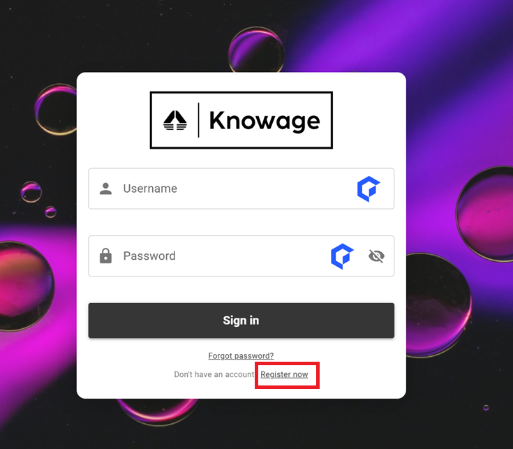

User registration
========================================================================================================================

.. important::
        Signup is available only when ``SPAGOBI.SECURITY.ACTIVE_SIGNUP_FUNCTIONALITY`` configuration is enabled.

From the login page, new users can register to Knowage just by clicking the  **Register** link:

   Login page

That brings the user to the registration page where the user can fill in personal information such as username and password (password constraints can be set using advanced configuration). After the registration the user will receive an email for confirmation. The account will be enabled only after confirmation.

   .. figure:: media/register_2.png

      User registration page

